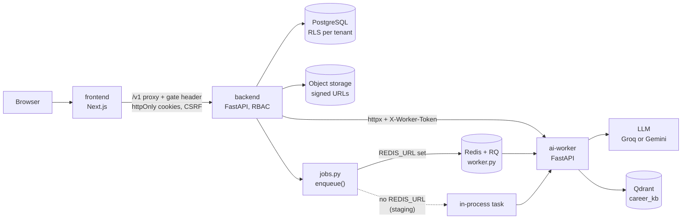

# Campus AI: multi-tenant campus platform with grounded AI career tools

A multi-tenant campus management and placement platform. One deployment serves
many institutes, and each institute's data is isolated **inside PostgreSQL**
with Row-Level Security (RLS). Students, teachers, training & placement officers
(TPOs), institute admins and external recruiters each get a role-specific
dashboard covering academics, attendance, placements and AI career tools.

The AI is wired end to end, not bolted on. A **retrieval-augmented (RAG) career
mentor** built with LangGraph, an **LLM résumé builder with ATS scoring**, and
**LLM scoring of skill evidence** all run in a separate AI service. The backend
owns identity, tenancy and stored data; the AI service does the model and vector
work.

> **Project status: public staging demo, not production-ready.**
> A staging deployment is publicly reachable at
> **<https://campus-ai-staging.vercel.app>**. It runs on free hosting plans with
> **synthetic data only**. Security reviews and automated tests were carried out
> during development, and a set of smoke tests passed on the hosted demo (see
> [Live staging demo](#2-live-staging-demo)). Several features have **not** been
> tested online, and some protections needed before real users are still open
> (see [Current limitations](#11-current-limitations)).

---

## Table of contents

1. [Problem statement](#1-problem-statement)
2. [Live staging demo](#2-live-staging-demo)
3. [Architecture](#3-architecture)
4. [Features](#4-features)
5. [AI and RAG](#5-ai-and-rag)
6. [Tenant isolation](#6-tenant-isolation)
7. [Security design](#7-security-design)
8. [Engineering decisions](#8-engineering-decisions)
9. [Running locally](#9-running-locally-development-only)
10. [Tests and CI](#10-tests-and-ci)
11. [Current limitations](#11-current-limitations)
12. [Repository layout](#12-repository-layout)
13. [What this project demonstrates](#13-what-this-project-demonstrates)

---

## 1. Problem statement

Campuses run on disconnected tools: one for attendance, another for placements,
spreadsheets for verifying student skills, and little in the way of personal
career guidance.

A plain LLM chatbot does not solve the guidance part. It has no access to a
student's real record, and it will confidently describe skills or projects the
student never had. Campus AI addresses this with two rules:

- **Retrieval (RAG):** answers draw on a curated career knowledge base stored in
  a vector database, not only on the model's training data.
- **A verified-data boundary:** the mentor only ever receives the student's
  **verified** profile, meaning skills and projects a teacher has approved.
  Unverified claims never enter the model's context, so the model cannot
  "confirm" them.

---

## 2. Live staging demo

**URL:** <https://campus-ai-staging.vercel.app>

This is a **staging** environment on free plans, with **synthetic data only**.
It is intended for trying the product, not for real or personal data. Demo
login details are not published in this repository.

### Hosting

| Component | Host (free plan) | Notes |
| --- | --- | --- |
| Frontend (Next.js) | Vercel | Public production URL. Preview deployments are set to require Vercel login. |
| Backend API (FastAPI) | Render web service | Only answers requests that carry a staging-gate header, which the frontend adds server-side. |
| AI worker (FastAPI) | Render web service | Every route except `/` and `/health` requires a worker token. |
| PostgreSQL + file storage | Supabase | Runtime role is `NOBYPASSRLS`; the storage bucket is private and uses signed URLs. |
| Vector database | Qdrant Cloud | Career knowledge base for the mentor. |
| LLM | Groq | Model chosen by configuration (`openai/gpt-oss-20b` on staging). |

### How the demo is protected

- **Backend gate:** the browser calls `/v1/...` on the frontend's own origin.
  A server-side proxy in the frontend (`frontend/src/proxy.ts`) forwards the
  call to the backend and adds a secret gate header. Calling the backend
  directly without that header returns **403** for everything except `GET
  /health`. A gate header sent by a visitor is overwritten.
- **AI worker token:** without the correct `X-Worker-Token`, the worker returns
  **401**. The token is compared in constant time, and in production the worker
  refuses to start with a token shorter than 32 characters.
- **Production mode:** staging runs with `ENVIRONMENT=production`. API docs,
  the OpenAPI schema and `/metrics` return **404**, cookies are `Secure`, and
  the API refuses to start with weak secrets or a superuser / `BYPASSRLS`
  database role.

### Tested on the hosted demo (November 2026)

Each item was a single manual smoke test with synthetic data:

- The public frontend loads, and its `/v1` proxy reaches the backend.
- Logging in with a seeded synthetic account.
- Submitting one skill claim. The AI worker scored it, and the claim stayed
  `pending` for a teacher's review (the AI score is advisory).
- One AI mentor question. Its references to the student's profile were
  checked against the database: they named only verified items, and no
  unverified skills.
- Generating one résumé version, and uploading a PDF to private storage
  through a signed upload URL.
- Storage checks: the bucket is private, signed links cannot be reused for
  other paths, and tampered links are refused.
- Access checks: backend gate (403), worker token (401), and docs and metrics
  closed (404).

### Not tested on the hosted demo

- **Face attendance.** It is disabled on staging (`FACE_ENABLED=false`) and
  has never been exercised there: the face routes return **503** before any
  model is loaded, and no face vector collection exists. The face model, its
  licence terms and its real-world behaviour have not been verified.
- **Public sign-up.** Institute sign-up and student registration exist in the
  code but have not been tested or hardened for public use (for example, abuse
  limits and quotas).
- ATS scoring, the recruiter portal and invites, bulk CSV import,
  notifications, and most teacher/TPO/admin workflows. These are covered by the
  automated tests below, but not exercised on the hosted demo.
- Behaviour under load or with many concurrent visitors.

### Free-tier behaviour to expect

- **Cold starts:** Render free services sleep after about 15 minutes of
  inactivity, and the first request after that is slow while the service
  starts again.
- **Slow first mentor answer:** after the AI worker wakes, the first mentor
  question downloads and loads the embedding model. On the hosted demo this
  took about 49 seconds, close to the backend's 60-second timeout, so the first
  question may sometimes fail. A retry a few minutes later is fast.
- **Background jobs are not durable:** staging has no Redis, so AI scoring runs
  inside the API process. If the API restarts, redeploys or sleeps mid-job, the
  claim stays `pending` with no AI score and is not retried.
- **Rate limits are in memory** and per instance, and visitors currently share
  one rate-limit bucket.

---

## 3. Architecture



| Component | Path | Stack |
| --- | --- | --- |
| Web UI | `frontend/` | Next.js 16, React 19, TypeScript, Tailwind CSS 4 |
| API | `backend/` | FastAPI, SQLAlchemy 2, Alembic, Pydantic, python-jose (JWT), slowapi |
| Job worker | `backend/jobs.py`, `backend/worker.py` | RQ on Redis, with an in-process fallback when Redis is absent |
| AI worker | `ai-worker/` | FastAPI, LangGraph / LangChain (Groq or Gemini), fastembed, Qdrant, InsightFace + ONNX Runtime |
| Shared observability | `packages/campus_obs/` | JSON logs with request IDs, Prometheus metrics, optional Sentry |
| Deployment templates | `deploy/` | Hardened Compose template and a policy checker |
| Backup scripts | `scripts/backup/` | Postgres backup/restore with restore verification, Qdrant snapshots |

**Representative request (mentor chat):**

```
Browser -> POST /v1/mentor/chat/stream                 backend/app/routers/mentor.py
  - authenticate (httpOnly cookie), set the tenant for RLS
  - build the VERIFIED-ONLY profile from PostgreSQL
  - load prior turns, store the user's message
  -> ai_client (httpx, timeout, retry, worker token)   backend/ai_client.py
  -> POST /mentor/chat/stream                          ai-worker/mentor.py
       LangGraph: START -> retrieve -> generate -> END
       retrieve: top-3 chunks from Qdrant              ai-worker/rag.py
       generate: LLM call, tokens streamed back (SSE)  ai-worker/llm.py
  <- tokens proxied to the browser as they arrive
  - the assistant's reply is stored on a fresh tenant-scoped session
```

Every AI feature follows the same pattern: browser → backend (auth, tenancy,
storage) → AI worker (model and vector work) → back to the backend.

---

## 4. Features

**Roles:** `student`, `teacher`, `tpo`, `admin`, `recruiter`. API routes enforce
role-based access control (RBAC).

- **Academics:** departments, timetable, assignments, gradebook, study
  materials, doubts (Q&A), calendar, announcements, leave / on-duty requests.
- **Attendance:** manual attendance. Face-recognition attendance exists in code
  but is **disabled on staging and untested** (see below).
- **Placements:** placement drives, applications, offers, internships,
  placement analytics for TPOs, and a recruiter portal where invited recruiters
  review candidates and manage offers.
- **Skill verification:** students submit skills and projects with evidence. The
  AI worker scores the evidence, and a teacher makes the final decision.
- **AI career tools:** an AI mentor, a résumé builder with version history and
  PDF upload, and ATS scoring against a job description.
- **Institute admin:** institute sign-up, user invitations and bulk CSV import,
  audit log, notifications, analytics.

---

## 5. AI and RAG

All model and vector work happens in `ai-worker/`, a separate FastAPI service.
The backend calls it over HTTP with a shared token, explicit timeouts and
retries (`backend/ai_client.py`). If the worker or the LLM is unavailable, the
AI features return errors and the rest of the platform keeps working.

**AI mentor** (`ai-worker/mentor.py`, `backend/app/routers/mentor.py`)

- A LangGraph `StateGraph` with two nodes: `retrieve → generate`.
- Answers stream to the browser as Server-Sent Events (SSE).
- Conversations are stored in PostgreSQL (tenant- and owner-scoped) and recent
  turns are replayed into each new question. The worker itself keeps no state.
- **Verified-data boundary:** `_build_verified_profile` includes only skills and
  projects with `verified` status.
- The prompt asks the model to label its sources (`[source: career knowledge]`,
  `[source: verified profile]`). This labelling is requested in the prompt,
  **not machine-enforced**.

**RAG** (`ai-worker/rag.py`, `ai-worker/kb.py`)

- A curated career knowledge base with a version number. It is re-indexed only
  when that version changes, so restarts do not duplicate vectors.
- Embeddings are computed inside the worker with fastembed
  (`all-MiniLM-L6-v2`, ONNX), so no external embedding API is needed.
- Qdrant collection `career_kb`, cosine similarity, top 3 chunks per question.
- Retrieval is document-level, with no reranking or hybrid search yet.

**Résumé and ATS** (`ai-worker/resume.py`, `backend/app/routers/resume.py`)

- Generates a Markdown résumé from the verified profile and stores it as a new
  version. A PDF can be attached to a version through private storage.
- ATS scoring compares a résumé with a job description and returns a 0–100
  score, matched and missing keywords, and suggestions. It asks the LLM for
  structured output and falls back to tolerant JSON parsing if the provider
  does not honour the schema.

**Skill evidence scoring** (`ai-worker/scoring.py`, `backend/jobs.py`)

- Runs as a background job so the student's submission returns immediately.
- With Redis configured, jobs go to an RQ queue with retries
  (`Retry(max=3, interval=[10, 30, 60])`) and a separate worker process. Without
  Redis (as on staging), they run as in-process tasks and are not durable.

**Face attendance** (`ai-worker/face.py`): **disabled on staging, untested.**
The code uses InsightFace (`buffalo_l`) embeddings stored in Qdrant, filtered by
tenant, and only *proposes* matches for a teacher to confirm. A `FACE_ENABLED`
switch makes every face route return 503 without loading the model. Face
embeddings are biometric data; any real use would need consent, a retention
policy and a legal review.

**Optional tooling:** Langfuse tracing of LLM calls (`ai-worker/tracing.py`) and
an offline evaluation script (`ai-worker/evals/run_evals.py`). Both do nothing
without their keys.

---

## 6. Tenant isolation

Isolation is enforced **by PostgreSQL**, not only by application `WHERE`
clauses.

- Each request sets the tenant with
  `SELECT set_config('app.current_tenant_id', :tid, true)`, which is scoped to
  the current transaction.
- RLS policies on tenant-scoped tables filter rows by that setting.
- **Connection-pool safety:** a listener on SQLAlchemy's `after_begin` event
  (`_reapply_tenant_guc` in `backend/app/core/db.py`) re-applies the tenant at
  the start of every transaction. Without it, a later transaction on a pooled
  connection could run without the tenant set.
- **Database roles:** the running app connects as a role that is
  `NOSUPERUSER NOBYPASSRLS`, so RLS cannot be skipped. Only one-off migration
  jobs use the owner role. In production the API refuses to start if its role
  is a superuser or has `BYPASSRLS`.
- **Known gap:** in the staging schema (migration head `f0a1b2c3d4e5`), 31 of
  39 tables have RLS enabled and forced. The other **8 do not**:
  - Five have a `tenant_id` column: `feedback`, `leads`, `users`,
    `tenant_invites` and `refresh_tokens` (the last has RLS enabled but not
    forced). The application filters these by tenant.
  - Three have no `tenant_id` column: `tenants` (the institute registry),
    `alembic_version` (migration bookkeeping) and `face_enrollments` (used only
    by the disabled face feature; scoped through the student it belongs to).

  The app role can read and write these tables, so for them isolation depends
  on the application code, not the database.
- **Observed staging permissions** (read-only checks, November 2026):
  - All tables are owned by the migration role.
  - The runtime role can read and write application data but cannot truncate
    tables or create objects.
  - Supabase's API roles (`anon`, `authenticated`, `service_role`) have **no
    privileges on any application table**, and there are no `PUBLIC` table
    grants.
  - Supabase's REST Data API is **not disabled**. At the time of the check it
    was failing with a schema-cache error and returned no data, but that is not
    a protection to rely on.
  - These are point-in-time checks, not a guarantee; they need re-checking
    after migrations or role changes.
- Cross-tenant behaviour is tested against real PostgreSQL with a
  `NOBYPASSRLS` role (`backend/tests_pg_api/`). That suite is not in CI yet.

---

## 7. Security design

These controls are implemented in code and covered by tests. They were checked
through internal reviews; there has been **no independent external audit or
penetration test**.

- **Authentication:** a JWT access token and a rotating, single-use refresh
  token, both in `httpOnly` cookies. Refresh tokens are stored as SHA-256
  digests, and reusing one revokes its whole token family. Passwords are hashed
  with bcrypt.
- **CSRF protection** on state-changing requests, with an explicit origin
  allow-list.
- **Invite tokens** are stored as SHA-256 digests, never in plaintext.
- **RBAC** on every feature route, and tenant isolation as described above.
- **Hardening:**
  - Rate limiting on sign-in, sign-up, refresh, invite acceptance and the
    public contact form. AI routes are not rate-limited yet.
  - Strict security headers and a CSP on the API and the frontend.
  - In production, `/docs`, `/openapi.json` and `/metrics` are not exposed.
  - The AI worker requires a shared token, compared in constant time.
  - Containers run as non-root users.
- **Startup checks:** with `ENVIRONMENT=production`, the API refuses to start
  with a weak `SECRET_KEY`, a missing `AI_WORKER_TOKEN`, or an over-privileged
  database role.
- **File storage:** the bucket is private. Uploads and downloads use short-lived
  signed URLs (downloads default to 10 minutes, at most 24 hours). Allowed file
  types are checked by extension.

---

## 8. Engineering decisions

| Decision | Why | Trade-off |
| --- | --- | --- |
| **Separate AI worker service** | Model and embedding work is heavy, has cold starts, and needs different dependencies from a CRUD API. | An extra network hop and a shared token to manage, in exchange for isolation and independent scaling. |
| **RLS in one shared database** | Isolation must be guaranteed by the database, not by remembering a `WHERE` clause. | RLS and connection pooling need care (handled in `db.py`), and all tenants share one database. |
| **LangGraph for the mentor** | A `retrieve → generate` graph can gain steps (tools, reranking) without a rewrite. | More structure than a single LLM call needs today. |
| **Qdrant + local embeddings** | A purpose-built vector store, with no paid embedding API. | Another stateful service to run; the model is downloaded on cold start. |
| **RQ with an in-process fallback** | Durable retries when Redis exists, zero extra infrastructure when it does not. | Without Redis, jobs are lost on restart (the staging situation). |
| **SSE for streaming** | One-way token streaming that proxies easily through the backend. | No client-to-server streaming (not needed). |
| **Same-origin `/v1` proxy on the frontend** | First-party cookies, and the backend only answers requests from the frontend. | The frontend host must hold the gate secret server-side. |

---

## 9. Running locally (development only)

> ⚠️ **The root `docker-compose.yml` is for local development only. Never
> deploy it or expose it to a network.**
> - It uses throwaway, publicly visible credentials for the database, the
>   `SECRET_KEY` and the worker token.
> - It connects to Postgres as the superuser, so **RLS is not enforced** in
>   this stack.
> - It sets `ENVIRONMENT=development`.
>
> Its ports are bound to `127.0.0.1` only. For a hardened setup, see
> `deploy/` instead.

**Requirements:** Docker with Compose v2.

```bash
# Optional: enable LLM features (the stack starts without them; AI calls will fail)
cp .env.example .env        # then add your own GROQ_API_KEY or GOOGLE_API_KEY

docker compose up --build

# The API does not run migrations on startup. Create the schema once:
docker compose run --rm backend alembic upgrade head
```

Then open:

- Frontend: <http://localhost:3000>
- API docs: <http://localhost:8000/docs> (available in development only)

To create demo data, run `backend/scripts/seed_demo.py`. It requires your own
`DEMO_SEED_PASSWORD` (at least 12 characters) and has no built-in accounts.
See `backend/scripts/README.md` for details.

Each service also has an env template for running outside Docker:
`backend/.env.example`, `ai-worker/env.example`, `frontend/demo.env.example`.
The backend and AI worker use [uv](https://docs.astral.sh/uv/) and Python 3.13
(`uv sync`). **Never commit real `.env` files.** The repo's `.gitignore`
excludes them.

---

## 10. Tests and CI

### GitHub Actions

`.github/workflows/ci.yml` runs on every push to `main` and on pull requests.
It uses a read-only token and no repository secrets, and pins each action to a
commit SHA.

| Job | What it runs |
| --- | --- |
| Backend tests | `uv sync --frozen`, then `pytest` on `backend/tests/` (SQLite, offline, AI calls stubbed), then a check that the shared observability modules are in sync |
| Frontend typecheck and lint | `npm ci`, `tsc --noEmit`, ESLint |
| Secret scan | gitleaks over the full git history, with redacted output. Reviewed exceptions are listed as exact fingerprints in `.gitleaksignore`. |

In the latest local run of the same backend command, 160 tests passed and 4
were skipped (the skipped tests need a PostgreSQL database).

### Test suites

| Suite | Location | What it covers | In CI? |
| --- | --- | --- | --- |
| Backend unit/API | `backend/tests/` | Auth, refresh rotation, CSRF, RBAC, tenant isolation, rate limiting, security headers, config hardening, invite hashing, job queue | **Yes** |
| Backend on real PostgreSQL | `backend/tests_pg_api/`, `backend/tests/test_rls_postgres.py` | Cross-tenant isolation under real RLS as a `NOBYPASSRLS` role, recruiter and face authorisation | **No.** Needs a disposable Postgres; the suite refuses to run against anything else (see `tests_pg_api/conftest.py`). |
| AI worker | `ai-worker/tests/` | Worker token check, production gates, tenant filtering for face search | No |
| Frontend E2E | `frontend/e2e/` | Playwright smoke tests and user flows | No. Needs a running stack and test accounts (see `frontend/e2e/README.md`). |
| Compose policy | `deploy/check_compose_prod.py` | Checks the production Compose template against security rules | No |

To run the backend suite locally: `cd backend && uv run pytest`.

---

## 11. Current limitations

Stated plainly so the project is not mistaken for more than it is:

- **Not production-ready.** The public demo is a free-tier staging deployment
  with synthetic data.
- **Public sign-up is not hardened.** Institute sign-up and student
  registration are reachable on the demo but have not been tested or protected
  for public use.
- **AI usage has no per-user limits yet,** so heavy use can exhaust the free LLM
  quota for everyone.
- **Rate limits are shared and in memory** on staging (all visitors currently
  share one bucket, and counters reset on restart).
- **Background jobs are not durable on staging** (no Redis).
- **Free-tier cold starts** on the backend and the AI worker.
- **Uploads:** file types are checked by extension only, and there is no
  application-level size limit. A signed download link keeps working until it
  expires, even if the file is deleted.
- **Face attendance** is disabled on staging and untested.
- **PostgreSQL RLS tests are not in CI yet**, nor are the AI-worker and E2E
  suites.
- **8 of 39 tables lack forced RLS** (five of them hold tenant data) and rely
  on application filtering (see [Tenant isolation](#6-tenant-isolation)).
- **Weak defaults to know about:** access tokens default to a 24-hour lifetime,
  and `ENVIRONMENT` defaults to `development`, so a deployment must set it
  explicitly.
- **Not load-tested.**
- **No license has been chosen yet.** Until one is added, default copyright
  applies.

**Next steps** (roughly in order): block or harden public sign-up, per-user
limits on AI routes, correct client-IP rate limiting behind the proxies, upload
size and type limits, PostgreSQL RLS tests in CI, and enforced source citations
for the mentor.

---

## 12. Repository layout

```
frontend/             Next.js app (src/app: public pages, dashboard/*: role dashboards; src/proxy.ts: /v1 proxy)
backend/              FastAPI API (app/routers, models, schemas, core), Alembic migrations, tests, scripts
ai-worker/            AI service (mentor + RAG, résumé/ATS, evidence scoring, face), tests, evals
packages/campus_obs/  Canonical observability modules synced into backend and ai-worker
deploy/               Production Compose template, env key template, policy checker
scripts/              Backup/restore scripts and the observability sync script
.github/workflows/    CI (backend tests, frontend checks, secret scan)
docker-compose.yml    Local development stack (development only, see above)
```

---

## 13. What this project demonstrates

- **Applied AI engineering:** LLM features wired end to end with auth, tenancy,
  storage, retries and graceful failure, plus a verified-data boundary against
  hallucinated profile details.
- **RAG:** local embeddings, Qdrant retrieval, version-gated indexing and a
  LangGraph pipeline with streaming.
- **Multi-tenant data design:** PostgreSQL RLS with least-privilege roles and a
  fix for a real connection-pooling pitfall.
- **Security engineering:** cookie auth with refresh-token rotation and reuse
  detection, CSRF, hashed invite tokens, startup gates, a gated backend and a
  token-protected AI service.
- **Delivery:** a working public staging deployment across five free services,
  CI with a secret scan, and documentation that names what is untested.

**Good areas to probe in an interview:** the untested items and limitations
above, test coverage of the AI paths, and how the design would change for real
users (durable jobs, per-user quotas, load testing).
