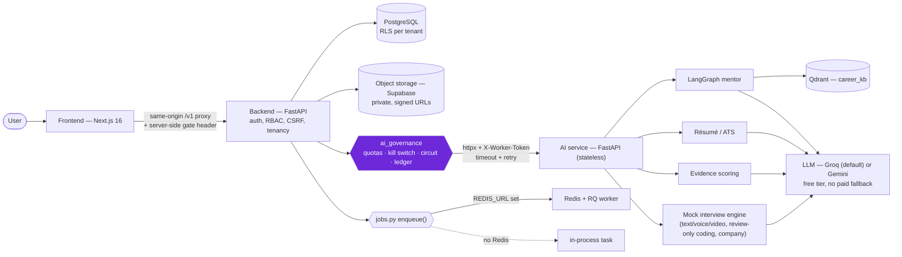
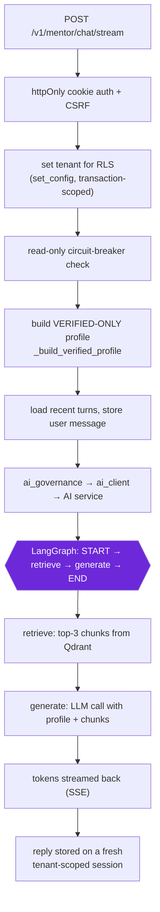
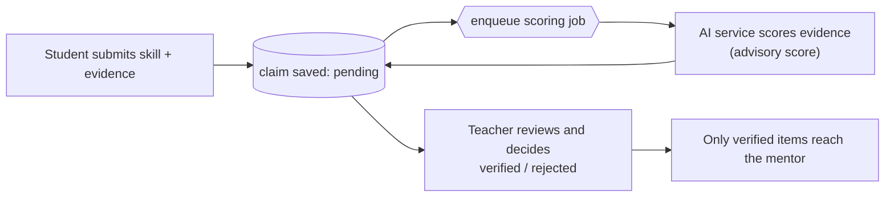

<div align="center">

# Campus AI

**One multi-tenant campus and placement platform with governed AI career tools, including an AI Mock Interview.**

One deployment serves many institutes, with each institute's data isolated inside PostgreSQL by Row-Level Security. FastAPI backend, separate FastAPI AI service (LangGraph mentor, RAG over Qdrant, résumé/ATS, evidence scoring, mock-interview engine), Next.js frontend, automated tests and a public free-tier staging demo.

[-6D28D9?style=flat-square)](https://campus-ai-staging.vercel.app)

-22C55E?style=flat-square)


</div>

> **Release status (2026-11-25): NOT production-ready.** The unified code
> (campus platform + AI Mock Interview + placement management + AI governance)
> exists on the **local** feature branch `feature/ai-mock-interview`. It has
> **not** been pushed, opened as a PR, merged or deployed. GitHub CI has never
> run on it, there has been no staging deployment, and no live AI provider calls
> have been made against it. The public demo still runs an **older build** from
> `main`. Section 5 lists the test evidence and its limits.

> **Reviewer TL;DR:** Five role dashboards (student, teacher, TPO, admin,
> recruiter) in one multi-tenant app. Tenant isolation is enforced **by
> PostgreSQL RLS** under a `NOBYPASSRLS` runtime role. A separate stateless AI
> service runs a **LangGraph `retrieve → generate` mentor** over a Qdrant
> knowledge base (it only sees a student's **teacher-verified** profile),
> résumé/ATS, evidence scoring and an **AI Mock Interview** engine. **Every AI
> path checks the kill switches**. Shared quotas, usage ledger, request limits
> and token caps apply when `AI_GOVERNANCE_ENABLED=true`, which **production
> startup requires**. All of this sits under a **₹0/month, free-tier-only** AI
> policy. New features ship
> behind flags that default **off**.

---

## Table of Contents

1. [Product Overview](#1-product-overview)
2. [System Design](#2-system-design)
3. [Engineering Decisions](#3-engineering-decisions)
4. [Feature Status](#4-feature-status)
5. [Verified Test Evidence](#5-verified-test-evidence)
6. [Live Staging Demo](#6-live-staging-demo)
7. [Limitations, Disabled Features & Open Work](#7-limitations-disabled-features--open-work)
8. [Local Setup, Migrations & Tests](#8-local-setup-migrations--tests)
9. [Deployment](#9-deployment)
10. [Repository Layout & Further Documentation](#10-repository-layout--further-documentation)

---

## 1. Product Overview

**User problem.** Campuses run on disconnected tools: one for attendance,
another for placements, spreadsheets for verifying student skills, and little
in the way of personal career guidance or interview practice. Institutes also
need their data kept strictly apart when they share one platform.

**Why a general chatbot alone is insufficient.** It has no access to a
student's real record, and it will confidently describe skills or projects the
student never had. For career advice, a confident wrong answer is worse than no
answer.

**The approach.** CampusAI is **one codebase and one product**. The AI Mock
Interview was built *into* the existing platform: it uses the same users, roles,
tenants, database, AI worker and AI governance. It is not a separate service. Four rules apply:

- **Retrieval (RAG):** mentor answers draw on a curated career knowledge base
  in a vector database, not only on the model's training data.
- **A verified-data boundary:** the mentor receives only skills and projects a
  teacher has **verified**. Unverified claims never enter the model's context.
- **Database-level tenancy:** every tenant-scoped query runs under PostgreSQL
  RLS, so a missing `WHERE tenant_id = …` cannot leak another institute's rows.
- **Governed AI:** every AI path (mentor, mentor streaming, résumé, ATS, proof
  scoring, mock interview, coding review, company profiles) calls
  `backend/app/services/ai_governance.py`. The kill switches are always
  checked. The shared quotas, usage ledger, request limits and token caps
  apply only when `AI_GOVERNANCE_ENABLED=true`. That flag is off in code but
  required for a production start.

### Roles and workflows

The five roles are defined in `backend/app/models/enums.py`.

| Role | Main workflows |
|---|---|
| **Student** | Timetable, assignments, attendance, study hub, doubts, leave/OD, ECA, skill/project claims with evidence, AI mentor, résumé builder + ATS, placement drives/applications/offers, internships, AI Mock Interview *(flagged)* |
| **Teacher** | Assignments, gradebook, attendance, study materials, doubts, **verifying** student skills and projects, faculty placement campaigns *(flagged)* |
| **TPO** | Placement drives, applications, offers, internships, placement analytics, recruiter invites; Placement Hub, campaigns, filtered analytics and CSV export *(flagged)*; interview company profiles *(flagged)* |
| **Admin** | Institute setup, departments, users and roles, bulk CSV import, invitations, audit log, analytics; AI Mock Interview operations console and company profiles *(flagged; admin edits, TPO can view)* |
| **Recruiter** | Invited access to candidates and offers for their institute |

*(flagged)* = behind a feature flag that defaults **off** (Section 4).

---

## 2. System Design

### High-Level Architecture



| Layer | Implementation |
|---|---|
| **Frontend** | `frontend/` Next.js 16 / React 19 / TypeScript (read `frontend/AGENTS.md` first). Pages in `src/app/dashboard/<feature>/page.tsx`, panels and API helpers in `src/components/<feature>/`. Same-origin `/v1` proxy in `src/proxy.ts`. Feature build flags `NEXT_PUBLIC_*`, all default off |
| **Backend** | `backend/` FastAPI, SQLAlchemy 2, Alembic. 37 router modules in `backend/app/routers/`, registered once in `FEATURE_ROUTERS` (`backend/main.py`) and mounted at `/v1` plus deprecated unversioned aliases. Tenant routers use `Depends(apply_tenant_guc)` |
| **AI service** | `ai-worker/` FastAPI + LangChain/LangGraph; one provider factory `ai-worker/llm.py`; interview engine in `ai-worker/interview/`. **Stateless**: only the backend calls it (`X-Worker-Token`, via `backend/ai_client.py`); the backend owns all persistence |
| **Database** | PostgreSQL with RLS: tenant tables carry `tenant_id` + `ENABLE/FORCE ROW LEVEL SECURITY` + a `tenant_isolation` policy on `app.current_tenant_id`; runtime role `app_user` is `NOBYPASSRLS` (production refuses a bypassing role). Models also run on SQLite for the offline test suite |
| **Auth** | JWT access + rotating single-use refresh tokens (stored as SHA-256 digests; reuse revokes the family) in `httpOnly` cookies or Bearer; bcrypt; CSRF origin check on every unsafe method; staging gate token |
| **Jobs** | `backend/jobs.py`: RQ on Redis when `REDIS_URL` is set (`backend/worker.py`), else in-process `BackgroundTasks` (lost on restart) |
| **Observability** | JSON logs with request IDs, Prometheus `/metrics` (token-protected; 404 in production without `METRICS_TOKEN`), Sentry with privacy scrubbing, `/health` + `/health/ready`. Interview LLM calls never reach Langfuse/LangSmith/Sentry AI integrations. `observability.py`/`errors.py`/`metrics.py` are synced from `packages/campus_obs/` |

The backend owns identity, tenancy and stored data. If the AI service or the
LLM is unavailable, AI features return errors and the rest of the platform keeps
working.

### Mentor Request Flow



The prompt asks the model to label sources (`[source: verified profile]`,
`[source: career knowledge]`). That labelling is **requested in the prompt, not
machine-enforced**.

### RAG Architecture

| Stage | Implementation | Boundary / trade-off |
|---|---|---|
| **Content** | Curated career knowledge base (`ai-worker/kb.py`, versioned) | Small, hand-written corpus; no user documents are indexed |
| **Indexing** | Re-indexed only when `KB_VERSION` changes | Document-level chunks, not token windows |
| **Embeddings** | fastembed `all-MiniLM-L6-v2` (ONNX, 384 dimensions) inside the AI service | No external embedding API |
| **Vector store** | Qdrant collection `career_kb`, cosine similarity | Required for the mentor |
| **Retrieval** | Top 3 chunks per question | No reranking, hybrid search or query rewriting |

No retrieval-quality or hallucination benchmark has been run.

### AI Governance (shared by every AI path)

- **Kill switches, always checked:** `AI_KILL_SWITCH` and per-feature
  `AI_DISABLED_FEATURES` are checked on every AI path, even when governance is
  off. By default nothing is killed.
- **Governance layer, only when `AI_GOVERNANCE_ENABLED=true`:** shared
  platform daily request/token caps (`AI_PLATFORM_DAILY_REQUEST_MAX`,
  `…_TOKEN_MAX`), institute/user request limits, provider-quota cooldown, the
  concurrency limit and the usage ledger (migration `f3a5c7e9b1d2`). With the
  flag **off** (the code default) none of these apply. The flag is **required
  in production**: a production backend refuses to start without it and its
  caps.
- **Circuit breaker** `AI_CIRCUIT_ENABLED` is on by default (approved exception)
  and stays inert while the mock interview is off. Its refusals do not consume
  AI budget.
- **Worker limits:** `LLM_TIMEOUT_SECONDS` and `LLM_MAX_RETRIES` are required in
  production.
- **Budget policy:** **₹0/month**, free tiers only, no paid fallback, no automatic
  billing. `AI_PRICE_TABLE` is empty by design ("cost not configured"), so prices
  are never invented.

### Skill Verification and Background Jobs



With Redis, jobs go to an RQ queue with retries and a separate worker process.
Without Redis, they run in the API process and are **lost** if it restarts
mid-job. The claim then stays `pending`; the teacher's decision is unaffected.

### Tenant Isolation & Security

- **RLS:** each request sets `app.current_tenant_id` with `set_config(..., true)`.
  A SQLAlchemy `after_begin` listener (`_reapply_tenant_guc` in
  `backend/app/core/db.py`) re-applies it on every transaction, so pooled
  connections never run without it. Objects outside the caller's tenant or
  ownership return **404**.
- **Roles:** the app connects as a `NOSUPERUSER NOBYPASSRLS` role; only one-off
  migrations use the owner role. In production the API refuses to start with a
  superuser or `BYPASSRLS` role, a weak `SECRET_KEY`, a missing worker token or
  missing AI-governance settings.
- **Hardening:** RBAC on feature routes, security headers and CSP, `/docs`
  `/openapi.json` closed in production, constant-time worker-token check,
  non-root containers.
- **Uploads:** files sent to the backend are size-checked in
  `backend/uploads.py`: CSV import is limited to **2 MB** and images (face
  enrolment, class photo) to **8 MB**. Résumé and other files go **directly to
  storage through signed upload URLs** (`backend/app/routers/files.py`). Those
  have an extension allow-list but **no verified server-side size limit**.
- **Known gap (staging schema, read-only check, November 2026):** 8 of 39
  tables there lacked forced RLS; for those, isolation depends on application
  filtering. Tables added since follow the RLS template.

There has been **no independent external audit or penetration test**.

---

## 3. Engineering Decisions

<details open>
<summary><b>Why a separate AI service?</b></summary>

**Need:** model and embedding work is heavy, has cold starts and needs different dependencies from a CRUD API.<br>
**Approach:** a second, stateless FastAPI app (`ai-worker/`) called over httpx with a shared token, explicit timeouts and retries.<br>
**Trade-off:** an extra network hop and a secret to manage, in exchange for dependency isolation and a clean failure boundary.
</details>

<details>
<summary><b>Why build the Mock Interview into the platform instead of a separate product?</b></summary>

**Need:** interview practice must use the same students, institutes, permissions and AI budget as everything else.<br>
**Approach:** new tenant tables with RLS, new routers under `/v1/mock-interview`, an interview engine in the existing worker, and the shared governance layer, all behind default-off flags.<br>
**Trade-off:** a larger single codebase; every interview feature must respect platform-wide rules (tenancy, governance, privacy).
</details>

<details>
<summary><b>Why RLS in one shared database instead of app-level filtering?</b></summary>

**Need:** institute isolation must be guaranteed, not left to every query remembering a `WHERE` clause.<br>
**Approach:** RLS policies keyed on a transaction-scoped setting, a `NOBYPASSRLS` runtime role, and a listener that re-applies the tenant on every transaction.<br>
**Trade-off:** RLS plus connection pooling has sharp edges, and all tenants share one database.
</details>

<details>
<summary><b>Why is the coding round review-only?</b></summary>

**Need:** running untrusted student code safely requires a hardened sandbox host.<br>
**Approach:** the coding round offers an editor plus AI *review* (hints, explanation turns, feedback, never a score) and executes **nothing**. A standalone gVisor runner (`code-runner/`) exists but is **not connected** to the backend. Hidden tests and reference solutions live in a separate private repository.<br>
**Trade-off:** no automated correctness checking until security gates G2–G5 pass.
</details>

<details>
<summary><b>Why only teacher-verified data in the mentor's context?</b></summary>

**Need:** the mentor must not "confirm" skills a student merely claimed.<br>
**Approach:** `_build_verified_profile` selects only `verified` skills and projects.<br>
**Trade-off:** the mentor knows less about new students until a teacher reviews their claims.
</details>

<details>
<summary><b>Why a same-origin <code>/v1</code> proxy with a gate header?</b></summary>

**Need:** first-party auth cookies, and a backend that only answers the frontend on free hosting without private networking.<br>
**Approach:** the frontend's server-side proxy forwards `/v1/*` and adds a secret header visitors cannot set; the backend rejects requests without it.<br>
**Trade-off:** the frontend host must hold that secret.
</details>

---

## 4. Feature Status

Status words: **Active** (in the code path with no flag) · **Flagged off**
(implemented locally, behind a flag that defaults off) · **Disabled**
(deliberately off for this release). Deployment status for all features: Section 7.

### Campus management (existing platform)

| Feature | Status |
|---|---|
| Academics, departments, timetable, calendar, announcements, assignments, gradebook, attendance, study materials, doubts, ECA, leave/OD, internships, notifications, people/users, institute, tenants, audit, analytics | Active |
| Bulk CSV user import, invitations (hashed invite tokens), student self-registration with admin approval | Active |
| Face attendance (`face`, `face-attendance`, `face-enroll`) | **Disabled**: worker `FACE_ENABLED` defaults to `false` (fail-closed); disabled for this release; untested |

### AI career tools

| Feature | Status |
|---|---|
| AI mentor (LangGraph RAG, SSE streaming, verified-only profile) | Active; governed |
| Résumé builder + ATS score | Active; governed |
| Skill/project evidence scoring (advisory; the teacher decides) | Active; governed |

### AI Mock Interview (Phases 1–8)

| Feature | Flag(s) | Status |
|---|---|---|
| Text HR + technical interview, evaluation report, history | backend `AI_MOCK_INTERVIEW_ENABLED` + `AI_MOCK_INTERVIEW_TENANT_IDS`; worker `MOCK_INTERVIEW_ENABLED`; frontend `NEXT_PUBLIC_MOCK_INTERVIEW_ENABLED` | Flagged off; no live LLM run on this tree |
| Voice interview (browser Web Speech; no server audio) | `AI_MOCK_INTERVIEW_VOICE_ENABLED` | Flagged off; real-device tests not done |
| Video interview (browser-only camera preview; no recording, upload or storage) | `AI_MOCK_INTERVIEW_VIDEO_ENABLED` + `…_VIDEO_TENANT_IDS`; `NEXT_PUBLIC_MOCK_INTERVIEW_VIDEO_ENABLED` | Flagged off; real-device checklist (24 rows) not done |
| Coding round, **review-only** (editor, AI hints/feedback, never a score; **no code executed**) | `AI_MOCK_INTERVIEW_CODING_ENABLED` + `…_CODING_TENANT_IDS`, `AI_MOCK_INTERVIEW_CODING_AI_ENABLED`; worker `MOCK_INTERVIEW_CODING_ENABLED`; `NEXT_PUBLIC_MOCK_INTERVIEW_CODING_ENABLED` | Flagged off; all 24 problems are drafts awaiting human review |
| Company interview profiles | `AI_MOCK_INTERVIEW_COMPANY_ENABLED`; worker `MOCK_INTERVIEW_COMPANY_ENABLED` | Flagged off |
| Operations console, quotas, usage ledger, alerts | `AI_MOCK_INTERVIEW_OPS_ENABLED`; `NEXT_PUBLIC_MOCK_INTERVIEW_OPS_ENABLED` | Flagged off |
| Student code execution (`code-runner/`, Docker + gVisor) | none (not connected) | **Disabled**: standalone and unconnected; Phase 8 security gates G2–G5 not passed |

### Placement and recruiter workflows

| Feature | Flag | Status |
|---|---|---|
| Placement drives, applications, offers, recruiter invites, recruiter candidate/offer views, placement analytics | none | Active |
| Placement Hub v2: placement core, bulk shortlist/reject, withdrawal, academic CSV/XLSX import, faculty campaigns (completion status only), TPO dashboard, filtered analytics, audited CSV export, links to mock-interview preparation | `PLACEMENT_MANAGEMENT_ENABLED` + `PLACEMENT_MANAGEMENT_TENANT_IDS` (empty = none) | Flagged off. Legacy pages and the Hub coexist; which one to keep is an open owner decision |

### Platform operations (Phase 10)

| Feature | Flag | Status |
|---|---|---|
| AI governance on every AI path | `AI_GOVERNANCE_ENABLED` (+ platform caps) | Off in code; **required in production** |
| Kill switch / per-feature disable | `AI_KILL_SWITCH`, `AI_DISABLED_FEATURES` | Default: nothing killed |
| Content-free client error reports | `CLIENT_ERROR_REPORTING_ENABLED`, `NEXT_PUBLIC_CLIENT_ERROR_REPORTING_ENABLED` | Flagged off |
| Encrypted DB + Storage backup / restore scripts | n/a (`scripts/backup/`) | Local simulated drill only; real destination is an open decision |

Not implemented: platform-operator role and enterprise integrations (open
scope decision), true multimodal AI.

---

## 5. Verified Test Evidence

> Each row is a **separate run**. The counts must **not** be added together.
> All runs were on a local Windows machine with no live AI calls. "Historical"
> means an earlier tree, before the final review fixes, and **not rerun** on the
> final tree.

| Check | Result | Date / tree | Status |
|---|---|---|---|
| **Full backend suite** (SQLite, offline, AI stubbed; run alone) | **835 passed, 0 failed, 34 skipped**, exit 0, ~62 min | 2026-11-25, frozen release candidate (HEAD `12029d6` + uncommitted Phase 10 tree) | **Tested locally** |
| ↳ the 34 skipped | Opt-in PostgreSQL RLS tests; `RLS_TEST_DATABASE_URL` was not set | same run | Not run in that run |
| Combined local integration smoke | 411 focused backend tests passed; 77 AI-worker integration tests passed; frontend TypeScript passed | 2026-11-25, after code freeze | **PARTIAL**: local Postgres, Redis, Qdrant and application servers were unavailable, so no live-infrastructure or browser-to-backend check ran |
| Frontend unit / lint / build | Unit **215/215**; `tsc` clean; lint 0 errors (2 pre-existing warnings in `e2e/smoke.spec.ts`); `next build` OK | 2026-11-25, Phase 10 run (frontend unchanged since) | Historical |
| PostgreSQL API suite (`tests_pg_api`, as `app_user`) | **245 passed, 0 failed, 0 skipped** | 2026-11-25, Phase 10 run before the findings fixes | **Historical — not rerun on the final tree** |
| PostgreSQL RLS suites | **34 passed, 0 failed** | same Phase 10 run | **Historical — not rerun on the final tree** |
| Backup/restore drill, load tests, failure drills | Passed locally with synthetic data and a **stand-in AI worker** | 2026-11-25 | Local simulation only |
| GitHub Actions CI (`.github/workflows/ci.yml`) | **Never ran** on this branch | n/a | Not tested |
| Live AI provider calls, staging, real email alerts, real devices/screen readers | **Not done** | n/a | Not tested / blocked |

**Final-tree PostgreSQL/RLS validation is pending.** This README does not claim
that every PostgreSQL/RLS test passes on the final tree.

### Repository facts (counted 2026-11-25)

| Metric | Value |
|---|---|
| Backend router modules | 37 (`backend/app/routers/*.py`, excluding `__init__.py`) |
| Alembic migrations | **62** revision files, single head **`f3a5c7e9b1d2`** (AI platform usage ledger, uncommitted) |
| Career knowledge base | Curated, versioned (`ai-worker/kb.py`) |

No production load, latency-percentile, cost or answer-quality figures are claimed.

---

## 6. Live Staging Demo

**URL:** <https://campus-ai-staging.vercel.app>. This is public staging on free
plans with **synthetic data only**. Do not enter real or personal data.

> **The demo runs an older build from `main`**. It includes none of the AI Mock
> Interview, Placement Hub v2 or AI governance work described above.
> The checks below were made on that older build in November 2026.

- The backend answers only requests carrying a secret gate header, which the
  frontend's server-side proxy adds. Direct calls get **403**.
- The AI service returns **401** without its token on every route except `/`
  and `/health`.
- Staging runs with `ENVIRONMENT=production`: API docs, the OpenAPI schema and
  `/metrics` return **404**, and cookies are `Secure`.

**Smoke-tested on the hosted demo (November 2026, older build):** frontend and
proxy, log-in with a seeded synthetic account, one skill claim scored and left
`pending`, one mentor question (only verified items named), one résumé version
and one PDF upload via a signed URL, private storage and tampered-link refusal,
access checks (403/401/404), face routes returning **503** (disabled). The first
mentor answer after an idle wake took about **49 s** (backend timeout 60 s).

**Not tested on the hosted demo:** face attendance, public sign-up, ATS
scoring, recruiter portal and invites, bulk CSV import, notifications, most
teacher/TPO/admin workflows, and any load.

---

## 7. Limitations, Disabled Features & Open Work

**Release status by category**

| Category | Items |
|---|---|
| **Committed locally** (not pushed) | Phases 1–9 of the Mock Interview/placement work and Phase 5 D3 (latest commit `12029d6`) |
| **Implemented locally, uncommitted** | Phase 10 production readiness (AI governance, config templates + policy check, CI workflow, monitoring, backup/restore, staging-verify and load scripts), `FACE_ENABLED` fail-closed, mentor breaker precheck |
| **Tested locally** | Full backend suite on the final tree (835/0/34); integration smoke (PARTIAL) |
| **Tested only in historical runs** | Frontend unit/lint/build; PostgreSQL API and RLS suites; AI-worker full suite |
| **Not tested** | GitHub CI; live AI providers; staging; real devices, screen readers and accessibility matrix; real email alert delivery; real backup restore |
| **Blocked by external access or owner approval** | Push/PR/merge, staging deployment and migration; provider free-limit and "no billing method" verification (caps); backup destination/retention/key custody (D7); monitoring accounts and alert e-mail; provider and hosting terms (OQ-3, OQ-5); `main` push / auto-deploy policy (OQ-6); Langfuse for non-interview AI (D9); platform-operator scope (OQ-1); legacy vs v2 placement pages; Phase 8 gates G2–G5 and human security acceptance |

**Release blockers still open:** AI caps not derived from verified provider
limits; dependency advisories (including `python-jose`/`ecdsa`, no fixed
version) awaiting review; GitHub CI never run; staging not running this code
(new mandatory env must be set **before** any redeploy, or both services refuse
to start; migration `f3a5c7e9b1d2` applied nowhere real); email alerts, backup
destination and live-AI runs unverified; Phase 8 security gates incomplete.

**Deliberately disabled for this release**

- **Student code execution:** no code is executed anywhere.
- **Face recognition:** `FACE_ENABLED=false`. Face embeddings are biometric data
  and would need consent, retention rules and legal review.
- **All new feature flags** default off; enabling one for an institute is an
  owner decision.

**Pilot limitations** (acceptable only if the owner accepts them in writing):
process-local concurrency limit and replay cache (single backend process); no
Redis on the free tier, so in-process jobs are lost on restart and rate limits
apply per instance; free hosting sleeps when idle (cold starts near the 60 s
worker timeout); mentor streaming counts requests only, not tokens.

**Public sign-up security is pending.** Institute sign-up and student
registration are reachable on the demo but have not been tested or hardened for
public use. This is not verified as fixed. (Student self-registration now
requires admin approval; that does not cover the rest of the public sign-up
risk.)

**Uploads:** only CSV import (2 MB) and image uploads (8 MB) have
server-side size limits. Résumé and other signed-URL uploads have **no
verified server-side size limit** and are checked by extension only. A signed
download link stays valid until it expires (default 10 minutes, hard cap
24 h), even if the file is deleted in the meantime.

**Other:** 24-hour access tokens; `ENVIRONMENT` defaults to `development`, so
deployments must set it; no license has been chosen yet (default copyright
applies).

---

## 8. Local Setup, Migrations & Tests

> ⚠️ **The root `docker-compose.yml` is for local development only.** It uses
> throwaway, publicly visible credentials, connects to Postgres as the
> superuser (so **RLS is not enforced** there), sets
> `ENVIRONMENT=development`, and binds ports to `127.0.0.1`. Never deploy it;
> see `deploy/` for the hardened template.

### Prerequisites

- Docker with Compose v2
- For running services outside Docker: Python 3.13 with
  [uv](https://docs.astral.sh/uv/), and Node.js
- Optional: a free-tier Groq or Gemini API key for AI features (the stack starts
  without one; AI calls fail). Under the ₹0 policy, never configure a paid key or
  billing.

### Environment configuration (templates only)

Copy a template and fill in **your own** values. Never commit real `.env` files
or paste their values into issues or logs.

| Template | For |
|---|---|
| `.env.example` | Root Compose stack (local development) |
| `backend/.env.example` | Backend run outside Docker |
| `ai-worker/env.example` | AI service |
| `frontend/demo.env.example` | Frontend demo settings |
| `deploy/prod.env.example` | Production key list (names only; checked by `deploy/check_compose_prod.py`) |

All feature flags (Section 4) default off; leave them off unless you are
deliberately testing a feature locally.

### Run locally

```bash
cp .env.example .env        # optional: add your own free-tier GROQ_API_KEY or GOOGLE_API_KEY
docker compose up --build
```

- Frontend: <http://localhost:3000>
- API docs: <http://localhost:8000/docs> (development only)

Demo data: `backend/scripts/seed_demo.py` needs your own `DEMO_SEED_PASSWORD`
(at least 12 characters) and has no built-in accounts; see
`backend/scripts/README.md`.

### Database migrations

The API does **not** run migrations on startup. The current chain has 62
revisions with a single head, `f3a5c7e9b1d2`. Migrations are **additive only**.

```bash
# Local development database (throwaway) only:
docker compose run --rm backend alembic upgrade head
```

Run Alembic only against a throwaway local database. Production and staging
migrations use the owner role through the deployment's `migrate` profile and
need explicit authorization (Section 9).

### Running tests

```bash
# Backend — full offline suite (SQLite throwaway DB, AI calls stubbed; ~1 h on Windows).
# All runs share %TEMP%\campus_ai_test.db: never run two backend pytest processes at once.
cd backend && uv sync --frozen && uv run pytest
#   (Windows venv equivalent: .venv/Scripts/python -m pytest)

# AI service. Without a disposable Qdrant server, exclude the two Qdrant-server test files:
cd ai-worker && uv run pytest --ignore=tests/test_face_qdrant_server.py --ignore=tests/test_face_tenant_filter.py

# Frontend
cd frontend && npm ci && npx tsc --noEmit && npm run lint && npm run test:unit && npm run build

# PostgreSQL API + RLS suites: disposable Postgres cluster ONLY
#   scripts/ci/pg_suite_setup.sh, then backend/tests_pg_api/ and the RLS test files
#   with RLS_TEST_DATABASE_URL set to the app-role URL of that disposable database.
```

| Suite | Location | In CI workflow? |
|---|---|---|
| Backend unit/API (offline) | `backend/tests/` | Yes (`backend` job) |
| Backup tools | `scripts/backup/` | Yes |
| Observability sync check | `scripts/sync_observability.py --check` | Yes |
| Frontend typecheck, lint, unit, build | `frontend/` | Yes (`frontend` job) |
| AI service (with a Qdrant service container) | `ai-worker/tests/` | Yes (`ai-worker` job) |
| PostgreSQL API + RLS suites | `backend/tests_pg_api/`, `backend/tests/test_*rls_postgres.py` (6 files) | Yes (`backend-postgres` job) |
| Playwright E2E | `frontend/e2e/` | No (needs a running stack and test accounts) |

The workflow is defined but has **never run on GitHub** for this branch.

---

## 9. Deployment

**No deployment of this code has happened.** The production template and its
runbooks are in `deploy/` (see [`deploy/README.md`](deploy/README.md)) and
`docs/mock-interview/runbooks/`.

Required order for any future deployment. Every step needs explicit owner
authorization.

1. Set the new mandatory environment **first**: backend `AI_GOVERNANCE_ENABLED`
   with `AI_PLATFORM_DAILY_REQUEST_MAX` / `AI_PLATFORM_DAILY_TOKEN_MAX`; worker
   `LLM_TIMEOUT_SECONDS` and `LLM_MAX_RETRIES`; `FACE_ENABLED=false`. Without
   them, both services refuse to start in production.
2. Validate the Compose/env policy: `deploy/check_compose_prod.py` reads the
   resolved Compose config as JSON on stdin. Use a **synthetic** env file
   (`deploy/make_synthetic_env.py`) and see `deploy/README.md`.
3. Deploy with every feature flag **off** (no behaviour change).
4. Run the additive migrations with the owner role (`migrate` profile), then
   verify `app_user` grants and RLS.
5. Run `scripts/ops/staging_verify.py` against staging.
6. Enable features per pilot institute only after the relevant gates pass.
   Roll back by turning flags off; data is kept.

**Vercel deploys every push to `main`.** Nothing is pushed to `main` without
explicit owner approval.

---

## 10. Repository Layout & Further Documentation

```
frontend/             Next.js app (src/app/dashboard/*: role dashboards; src/proxy.ts: /v1 proxy)
backend/              FastAPI API (app/routers, models, services, core), Alembic migrations, tests, tests_pg_api, scripts
ai-worker/            AI service (mentor + RAG, résumé/ATS, scoring, face, interview/ engine), tests
code-runner/          Standalone Docker + gVisor runner (NOT connected to the backend)
packages/campus_obs/  Canonical observability modules synced into backend and ai-worker
deploy/               Production Compose template, env key template, policy checker
scripts/              Backup/restore, CI Postgres setup, load harness, ops verification, observability sync
docs/                 Release handoff and AI Mock Interview state, specs and runbooks
.github/workflows/    CI workflow (not yet run for this branch)
docker-compose.yml    Local development stack (development only)
```

| Document | Purpose |
|---|---|
| [`docs/CAMPUSAI_UNIFIED_RELEASE_HANDOFF.md`](docs/CAMPUSAI_UNIFIED_RELEASE_HANDOFF.md) | Release source of truth: Git state, evidence, blockers, owner decisions, roadmap |
| [`docs/mock-interview/PROJECT_STATE.md`](docs/mock-interview/PROJECT_STATE.md) | Phase-by-phase status and history |
| [`docs/mock-interview/IMPLEMENTATION_PLAN.md`](docs/mock-interview/IMPLEMENTATION_PLAN.md) | Plan and roadmap |
| `docs/mock-interview/specs/` | Phase specs, incl. `phase-10-production-readiness.md` (gates, evidence) |
| `docs/mock-interview/runbooks/` | Operations runbooks (AI governance, alerts, backup/restore) |
| [`deploy/README.md`](deploy/README.md) | Deployment notes |

---

<div align="center">

**Author: Vishal Shivhare** · GenAI / Backend Engineer

[](https://github.com/Vishal-AI-ML-Dev)

No license has been chosen yet; default copyright applies.

</div>
