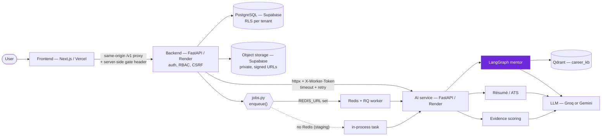
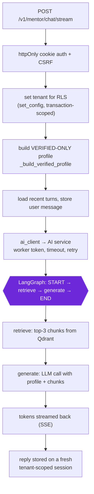
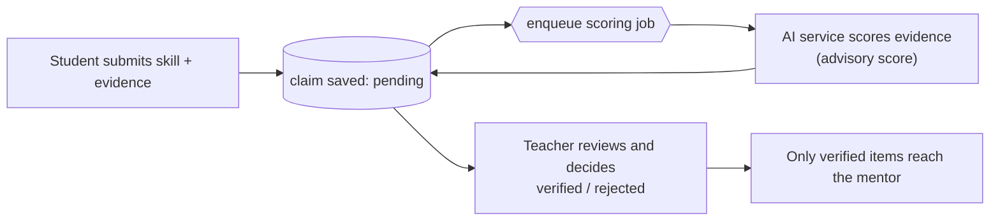
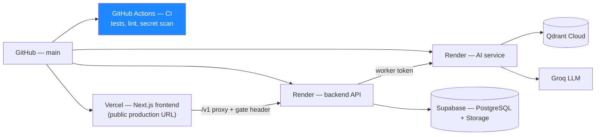

<div align="center">

# Campus AI

**A multi-tenant campus and placement platform with grounded AI career tools.**

One deployment serves many institutes, with each institute's data isolated inside PostgreSQL by Row-Level Security. FastAPI backend, separate FastAPI AI service (LangGraph mentor, RAG over Qdrant, résumé/ATS, evidence scoring), Next.js frontend, automated tests and a public free-tier staging demo.

[](https://campus-ai-staging.vercel.app)
[](https://github.com/Vishal-AI-ML-Dev/campus-ai/actions/workflows/ci.yml)


</div>

> **Reviewer TL;DR:** Five role dashboards (student, teacher, TPO, admin,
> recruiter) in one multi-tenant app. Tenant isolation is enforced **by
> PostgreSQL RLS** under a `NOBYPASSRLS` runtime role, with a fix for a real
> connection-pooling pitfall. A separate AI service runs a **LangGraph
> `retrieve → generate` mentor** over a Qdrant knowledge base, and only ever
> sees a student's **teacher-verified** profile. CI runs 160 offline backend
> tests, frontend typecheck/lint and a gitleaks history scan on every push.
> The public demo is **staging on free plans with synthetic data**: a handful
> of smoke tests passed online, face attendance is **disabled**, and public
> sign-up and AI-quota protections are **still pending**.

> **Free-tier note:** the backend and AI service sleep when idle, so the first
> request after a pause is slow, and the first mentor question after a wake
> took about 49 s on the hosted demo (the backend timeout is 60 s). Demo
> logins are not published in this repository.

---

## Table of Contents

1. [Problem Statement](#1-problem-statement)
2. [System Design](#2-system-design)
3. [Engineering Decisions](#3-engineering-decisions)
4. [Engineering Features](#4-engineering-features)
5. [Verified Numbers](#5-verified-numbers)
6. [Live Staging Demo](#6-live-staging-demo)
7. [Limitations & Open Work](#7-limitations--open-work)
8. [Local Setup & Tests](#8-local-setup--tests)
9. [For Reviewers & Recruiters](#9-for-reviewers--recruiters)
10. [Repository Layout](#10-repository-layout)

---

## 1. Problem Statement

**User problem.** Campuses run on disconnected tools: one for attendance,
another for placements, spreadsheets for verifying student skills, and little
in the way of personal career guidance. Institutes also need their data kept
strictly apart when they share one platform.

**Why a general chatbot alone is insufficient.** It has no access to a
student's real record, and it will confidently describe skills or projects the
student never had. For career advice, a confident wrong answer is worse than no
answer.

**The approach.** Campus AI combines three rules:

- **Retrieval (RAG):** mentor answers draw on a curated career knowledge base
  in a vector database, not only on the model's training data.
- **A verified-data boundary:** the mentor receives only skills and projects a
  teacher has **verified**. Unverified claims never enter the model's context.
- **Database-level tenancy:** every tenant-scoped query runs under PostgreSQL
  RLS, so a missing `WHERE tenant_id = …` cannot leak another institute's rows.

### Roles and workflows

| Role | Main workflows |
|---|---|
| **Student** | Timetable, assignments, attendance, skill/project claims with evidence, AI mentor, résumé builder + ATS, placement drives and applications |
| **Teacher** | Assignments, gradebook, attendance, study materials, doubts, **verifying** student skills and projects |
| **TPO** | Placement drives, applications, offers, internships, placement analytics, recruiter invites |
| **Admin** | Institute setup, users and roles, bulk CSV import, invitations, audit log, analytics |
| **Recruiter** | Invited access to candidates and offers for their institute |

> **Scope distinction:** only the mentor uses LangGraph. Résumé/ATS and evidence
> scoring are direct LLM calls in the AI service; everything else is ordinary
> backend logic.

---

## 2. System Design

### High-Level Architecture



The backend owns identity, tenancy and stored data. The AI service is
stateless compute. If it or the LLM is unavailable, AI features return errors
and the rest of the platform keeps working.

### Mentor Request Flow



The prompt asks the model to label sources (`[source: verified profile]`,
`[source: career knowledge]`). That labelling is **requested in the prompt, not
machine-enforced**.

### RAG Architecture

| Stage | Implementation | Boundary / trade-off |
|---|---|---|
| **Content** | Curated career knowledge base (`ai-worker/kb.py`, 11 documents, versioned) | Small, hand-written corpus; no user documents are indexed |
| **Indexing** | Re-indexed only when `KB_VERSION` changes, so restarts do not duplicate vectors | Document-level chunks, not token windows |
| **Embeddings** | fastembed `all-MiniLM-L6-v2` (ONNX, 384 dimensions), computed inside the AI service | No external embedding API; the model downloads on a cold start |
| **Vector store** | Qdrant collection `career_kb`, cosine similarity | Required for the mentor |
| **Retrieval** | Top 3 chunks per question | No reranking, hybrid search or query rewriting |
| **Grounding** | Chunks plus the verified profile go into the system prompt | Source labels are prompt-instructed, not verified per claim |

No retrieval-quality or hallucination benchmark has been run.

### Skill Verification and Background Jobs



With Redis, jobs go to an RQ queue with `Retry(max=3, interval=[10, 30, 60])`
and a separate worker process. Without Redis (as on staging), they run in the
API process and are **lost** if it restarts mid-job. The claim then stays
`pending` with no AI score; the teacher's decision is unaffected.

### Tenant Isolation & Security

- **RLS:** each request sets `app.current_tenant_id` with
  `set_config(..., true)`. A SQLAlchemy `after_begin` listener
  (`_reapply_tenant_guc` in `backend/app/core/db.py`) re-applies it at the
  start of every transaction, so pooled connections never run without it.
- **Roles:** the app connects as a `NOSUPERUSER NOBYPASSRLS` role; only one-off
  migrations use the owner role. In production the API refuses to start with a
  superuser or `BYPASSRLS` role, a weak `SECRET_KEY` or a missing worker token.
- **Known gap:** 8 of 39 tables lack forced RLS (5 of them hold tenant data:
  `feedback`, `leads`, `users`, `tenant_invites`, `refresh_tokens`). For those,
  isolation depends on application filtering.
- **Auth:** JWT access token plus a rotating, single-use refresh token, both in
  `httpOnly` cookies. Refresh tokens are stored as SHA-256 digests; reusing one
  revokes its whole family. Passwords use bcrypt. CSRF protection with an
  origin allow-list on state-changing requests. Invite tokens are stored as
  SHA-256 digests.
- **Hardening:** RBAC on feature routes, security headers and a CSP on the API
  and frontend, `/docs` `/openapi.json` `/metrics` closed in production,
  constant-time worker-token check, non-root containers.
- **Not yet in place:** rate limits on AI routes, upload size limits,
  content-type checks beyond the file extension, and hardened public sign-up.

There has been **no independent external audit or penetration test**.

### Staging Deployment



Vercel deploys each push to `main` through its own GitHub integration; the
Render services build from this repository, but whether they auto-deploy on
every push has not been verified. CI does **not** gate deployments. Secrets
live in the platform dashboards, not the repository.

---

## 3. Engineering Decisions

<details open>
<summary><b>Why a separate AI service?</b></summary>

**Need:** model and embedding work is heavy, has cold starts, and needs different dependencies (LangChain, fastembed, InsightFace) from a CRUD API.<br>
**Approach:** a second FastAPI app (`ai-worker/`) called over httpx with a shared token, explicit timeouts and retries.<br>
**Trade-off:** an extra network hop and a secret to manage, in exchange for dependency isolation, independent scaling and a clean failure boundary.
</details>

<details>
<summary><b>Why RLS in one shared database instead of app-level filtering?</b></summary>

**Need:** institute isolation must be guaranteed, not left to every query remembering a `WHERE` clause.<br>
**Approach:** RLS policies keyed on a transaction-scoped setting, a `NOBYPASSRLS` runtime role, and a listener that re-applies the tenant on every transaction.<br>
**Trade-off:** RLS plus connection pooling has sharp edges; all tenants share one database; 8 tables still rely on application filtering.
</details>

<details>
<summary><b>Why LangGraph for the mentor only?</b></summary>

**Need:** a retrieve-then-generate pipeline that can gain steps (tools, reranking) without a rewrite.<br>
**Approach:** a `StateGraph` with `retrieve` and `generate` nodes, streamed over SSE. Résumé/ATS and scoring stay as direct LLM calls.<br>
**Trade-off:** more structure than two steps need today; the app has two orchestration styles.
</details>

<details>
<summary><b>Why only teacher-verified data in the mentor's context?</b></summary>

**Need:** the mentor must not "confirm" skills a student merely claimed.<br>
**Approach:** `_build_verified_profile` selects only `verified` skills and projects; pending and rejected claims are excluded.<br>
**Trade-off:** the mentor knows less about new students until a teacher reviews their claims.
</details>

<details>
<summary><b>Why RQ with an in-process fallback?</b></summary>

**Need:** scoring should not block the student's request, but small deployments should not need extra infrastructure.<br>
**Approach:** RQ on Redis with retries when `REDIS_URL` is set; FastAPI background tasks otherwise.<br>
**Trade-off:** without Redis, jobs are not durable. That is the current staging situation.
</details>

<details>
<summary><b>Why a same-origin <code>/v1</code> proxy with a gate header?</b></summary>

**Need:** first-party auth cookies, and a backend that only answers the frontend on free hosting without private networking.<br>
**Approach:** the frontend's server-side proxy forwards `/v1/*` to the backend and adds a secret header that visitors cannot set; the backend rejects requests without it.<br>
**Trade-off:** the frontend host must hold that secret; old deployment URLs keep serving their old build until deleted.
</details>

---

## 4. Engineering Features

| Feature | Implementation / evidence | Scope |
|---|---|---|
| **Tenant isolation** | PostgreSQL RLS, `NOBYPASSRLS` runtime role, per-transaction re-apply | 31 of 39 tables forced; 8 rely on app filtering |
| **AI mentor** | LangGraph `retrieve → generate`, SSE streaming, conversations stored per tenant and owner | Source labels prompt-instructed |
| **RAG** | fastembed MiniLM embeddings, Qdrant `career_kb`, top-3 retrieval, version-gated indexing | Small curated corpus; no reranking |
| **Résumé & ATS** | Markdown résumé from the verified profile, version history, PDF upload; ATS score with structured output and a JSON-parsing fallback | ATS not tested on the hosted demo |
| **Evidence scoring** | Background job, advisory score, teacher decides | Not durable without Redis |
| **Face attendance** | InsightFace + Qdrant, tenant-filtered, teacher confirms matches, `FACE_ENABLED` switch | **Disabled on staging; untested** |
| **Authentication** | JWT + rotating hashed refresh tokens in `httpOnly` cookies, reuse detection, bcrypt, CSRF | Access tokens default to 24 h |
| **API hardening** | RBAC, security headers/CSP, closed docs/metrics in production, startup gates | Sign-in/sign-up rate-limited; AI routes are not |
| **Storage** | Private bucket, short-lived signed upload/download URLs, extension allow-list | No size limit; deleted files stay reachable until a link expires |
| **Observability** | JSON logs with request IDs, Prometheus metrics, optional Sentry and Langfuse | Metrics closed in production; no monitoring configured on staging |
| **CI** | GitHub Actions: backend tests, frontend typecheck/lint, gitleaks history scan | PostgreSQL, AI-service and E2E suites not in CI |
| **Deployment** | Vercel + Render + Supabase + Qdrant Cloud + Groq, free plans | Staging only |

---

## 5. Verified Numbers

> Counted from the repository at the current commit or recorded during this
> project's own checks. These are not production benchmarks.

| Metric | Value | Qualification |
|---|---|---|
| Backend API | **29 router modules, 162 route handlers** | Served under `/v1` (plus deprecated unversioned aliases) |
| AI service | **13 route handlers** | Mentor (2), résumé/ATS (2), scoring (1), face (5), root/health/metrics (3) |
| Database migrations | **51 Alembic migrations** | Head `f0a1b2c3d4e5` |
| RLS coverage (staging schema) | **31 of 39 tables** enabled and forced | Read-only check, November 2026 |
| Backend tests | **160 passed, 4 skipped** | Offline SQLite suite, AI calls stubbed; skipped tests need PostgreSQL. Local run of the CI command |
| CI run time | **~2–2.5 min** backend, **under 1.5 min** frontend, **under 15 s** secret scan | First GitHub Actions runs |
| Career knowledge base | **11 documents** | Hand-written, versioned |
| First mentor answer after a wake | **~49 s** on the hosted demo | One measurement; ~1 s for later requests in local tests |
| Memory at a 512 MB cap | Backend ~120 MiB; AI service ~85 MiB idle, ~305 MiB peak during mentor retrieval | Measured locally, not on Render |

No load, latency-percentile, cost or answer-quality figures are claimed.

---

## 6. Live Staging Demo

**URL:** <https://campus-ai-staging.vercel.app>. Public staging on free plans,
with **synthetic data only**. Do not enter real or personal data.

**How it is protected**

- The backend answers only requests carrying a secret gate header, which the
  frontend's server-side proxy adds (`frontend/src/proxy.ts`). Direct calls get
  **403**; a gate header sent by a visitor is overwritten.
- The AI service returns **401** without its token on every route except `/`
  and `/health`.
- Staging runs with `ENVIRONMENT=production`: API docs, the OpenAPI schema and
  `/metrics` return **404**, and cookies are `Secure`.

**Tested on the hosted demo (November 2026)**, each as a single smoke test:

- Public frontend loads; its `/v1` proxy reaches the backend.
- Log-in with a seeded synthetic account.
- One skill claim scored by the AI service and left `pending` for a teacher.
- One mentor question, whose profile references were checked against the
  database: only verified items were named.
- One résumé version generated; one PDF uploaded through a signed URL.
- Storage: bucket private, signed links not reusable for other paths, tampered
  links refused.
- Access checks: gate (403), worker token (401), docs and metrics (404).
- Face routes return **503** (disabled) without loading any model.

**Not tested on the hosted demo:** face attendance, public sign-up, ATS
scoring, the recruiter portal and invites, bulk CSV import, notifications,
most teacher/TPO/admin workflows, and any load or concurrency.

---

## 7. Limitations & Open Work

- **Not production-ready.** The demo is free-tier staging with synthetic data.
- **Public sign-up security is pending.** Institute sign-up and student
  registration are reachable on the demo but have not been tested or hardened
  for public use.
- **No per-user AI limits yet,** so heavy use can exhaust the free LLM quota
  for everyone. Rate limits on staging are in memory and currently shared by
  all visitors.
- **Uploads:** extension checks only, no size limit; signed download links stay
  valid until they expire (up to 24 h), even after a file is deleted.
- **Background jobs are not durable on staging** (no Redis), and **free-tier
  cold starts** apply to both Render services.
- **Face attendance is disabled** on staging and untested. Its model, licence
  terms and real-world behaviour are unverified, and face embeddings are
  biometric data that would need consent, retention rules and legal review.
- **Database:** 8 of 39 tables lack forced RLS. Supabase's REST Data API is
  **not disabled**; Supabase's API roles had no privileges on application
  tables in a November 2026 read-only check, which is a point-in-time
  observation, not a guarantee.
- **Test gaps:** the PostgreSQL RLS suite, AI-service tests and Playwright E2E
  specs are **not in CI**. No retrieval or answer-quality evaluation has been
  run. Not load-tested.
- **Weak defaults:** 24-hour access tokens; `ENVIRONMENT` defaults to
  `development`, so deployments must set it.
- **No license has been chosen yet.** Default copyright applies.

**Next steps** (roughly in order): block or harden public sign-up, per-user
limits on AI routes, correct client-IP rate limiting behind the proxies, upload
size and type limits, PostgreSQL RLS tests in CI, enforced mentor citations.

---

## 8. Local Setup & Tests

> ⚠️ **The root `docker-compose.yml` is for local development only.** It uses
> throwaway, publicly visible credentials, connects to Postgres as the
> superuser (so **RLS is not enforced** there), sets
> `ENVIRONMENT=development`, and binds ports to `127.0.0.1`. Never deploy it;
> see `deploy/` for a hardened template.

### Prerequisites

- Docker with Compose v2
- Optional: a Groq or Gemini API key for AI features (the stack starts without
  one; AI calls fail)
- For running services outside Docker: Python 3.13 with
  [uv](https://docs.astral.sh/uv/), and Node.js

```bash
cp .env.example .env        # optional: add your own GROQ_API_KEY or GOOGLE_API_KEY
docker compose up --build

# The API does not run migrations on startup. Create the schema once:
docker compose run --rm backend alembic upgrade head
```

- Frontend: <http://localhost:3000>
- API docs: <http://localhost:8000/docs> (development only)

Demo data: `backend/scripts/seed_demo.py` requires your own `DEMO_SEED_PASSWORD`
(at least 12 characters) and has no built-in accounts; see
`backend/scripts/README.md`. Env templates: `backend/.env.example`,
`ai-worker/env.example`, `frontend/demo.env.example`. **Never commit real
`.env` files.**

### Running Tests

```bash
# Backend (offline: throwaway SQLite, AI calls stubbed)
cd backend && uv sync --frozen && uv run pytest

# Frontend
cd frontend && npm ci && npx tsc --noEmit && npm run lint
```

| Suite | Location | In CI? |
|---|---|---|
| Backend unit/API: auth, refresh rotation, CSRF, RBAC, tenant isolation, rate limits, headers, config gates, invite hashing, jobs | `backend/tests/` | **Yes** |
| Frontend typecheck and lint | `frontend/` | **Yes** |
| Secret scan (gitleaks, full history; reviewed exceptions as exact fingerprints in `.gitleaksignore`) | repository | **Yes** |
| Real-PostgreSQL RLS: cross-tenant isolation as a `NOBYPASSRLS` role, recruiter and face authorisation | `backend/tests_pg_api/`, `backend/tests/test_rls_postgres.py` | No (needs a disposable Postgres; see `tests_pg_api/conftest.py`) |
| AI service: worker token, production gates, face tenant filtering | `ai-worker/tests/` | No |
| Playwright E2E | `frontend/e2e/` | No (needs a running stack and test accounts) |
| Compose policy check | `deploy/check_compose_prod.py` | No |

CI (`.github/workflows/ci.yml`) runs on pushes to `main` and on pull requests,
with a read-only token, no repository secrets and actions pinned to commit SHAs.

---

## 9. For Reviewers & Recruiters

**Start here:** [live staging demo](https://campus-ai-staging.vercel.app) ·
[CI runs](https://github.com/Vishal-AI-ML-Dev/campus-ai/actions/workflows/ci.yml) ·
[deployment notes](deploy/README.md)

| Competency | Evidence in this repository |
|---|---|
| **System design** | Separate API and AI services, job queue with fallback, same-origin proxy, documented failure boundaries |
| **Multi-tenant data** | PostgreSQL RLS, least-privilege roles, a fix for RLS under connection pooling, an honest list of unforced tables |
| **Applied AI / RAG** | LangGraph mentor, Qdrant retrieval, version-gated indexing, SSE streaming, a verified-data boundary |
| **Backend engineering** | FastAPI, SQLAlchemy 2, Alembic (51 migrations), Pydantic, background jobs |
| **Security** | Cookie auth with rotating hashed refresh tokens and reuse detection, CSRF, hashed invite tokens, startup gates, gated backend |
| **Full-stack & DevOps** | Next.js 16 / React 19 / TypeScript, Docker, GitHub Actions with a secret scan, a five-service free-tier deployment |

**Good areas to probe:** the pending sign-up and AI-quota protections, the 8
tables without forced RLS, tests not yet in CI, and how the design would change
for real users (durable jobs, per-user quotas, load testing).

**The throughline:** an integrated, multi-service product owned end to end,
with a clear line between what is implemented, what was tested online, and
what is still open.

---

## 10. Repository Layout

```
frontend/             Next.js app (src/app: public pages, dashboard/*: role dashboards; src/proxy.ts: /v1 proxy)
backend/              FastAPI API (app/routers, models, schemas, core), Alembic migrations, tests, scripts
ai-worker/            AI service (mentor + RAG, résumé/ATS, evidence scoring, face), tests, evals
packages/campus_obs/  Canonical observability modules synced into backend and ai-worker
deploy/               Production Compose template, env key template, policy checker, staging notes
scripts/              Backup/restore scripts and the observability sync script
.github/workflows/    CI (backend tests, frontend checks, secret scan)
docker-compose.yml    Local development stack (development only, see above)
```

---

<div align="center">

**Author: Vishal Shivhare** · GenAI / Backend Engineer

[](https://github.com/Vishal-AI-ML-Dev)

No license has been chosen yet; default copyright applies.

</div>
